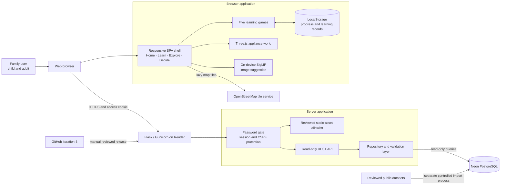
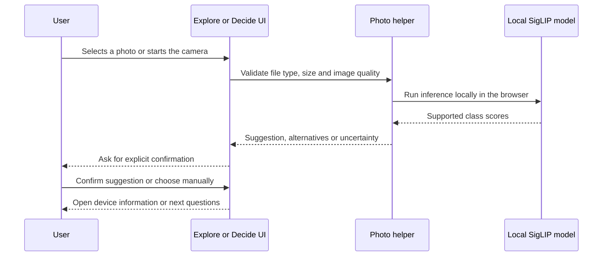
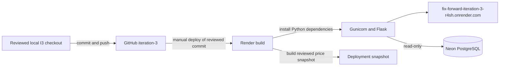

# FixForward Iteration 3 — System Architecture Report

**Project:** FixForward

**Iteration:** Iteration 3

**Report date:** 13 October 2026

**Reviewed application branch:** `iteration-3`

**Reviewed application baseline:** [`f786dd8`](https://github.com/dilan-monash/fix-forward/commit/f786dd808c601d3f0fac8c08584cfd9b96ec8fe7)

**Review website:** [https://fix-forward-iteration-3-r4sh.onrender.com/](https://fix-forward-iteration-3-r4sh.onrender.com/)

## 1. Executive summary

FixForward Iteration 3 is a protected family learning website that helps children and adults understand repair, reuse and responsible e-waste recycling. It combines five browser-based learning activities, an interactive 3D appliance explorer and an adult decision pathway for real household items.

The system uses a modular JavaScript frontend served by a Python Flask application. The browser runs the learning games, 3D rendering and optional image classification. Flask controls access, serves an explicit allowlist of reviewed assets and exposes read-only reference-data APIs. PostgreSQL on Neon supplies appliance, recall, safety, price and service information. Render hosts the Flask service from the GitHub `iteration-3` branch through a manually controlled release process.

The architecture separates fictional learning activities from real-appliance guidance. Children can practise decisions without creating an account, while adults receive clear safety boundaries and must confirm any AI-generated device suggestion before it is used.

## 2. Architecture goals

The I3 architecture was designed to:

1. Provide one consistent website for learning, exploring and making an adult-guided decision.
2. Keep the five learning games modular so each activity owns its rules, feedback and learning record.
3. Run image classification locally in the browser so selected photos are not uploaded to the server.
4. Use Neon data through read-only APIs and keep database credentials outside the frontend and repository.
5. Protect the review website with a shared server-side access gate.
6. Support keyboard navigation, reduced motion, clear feedback and responsive layouts.
7. Fail safely when AI, camera, location, 3D or database services are unavailable.
8. Keep I3 isolated from Main, Iteration 2 and retired prototype routes.

## 3. High-level system architecture

The diagram separates four trust boundaries:

- **Browser boundary:** interaction, game progress, 3D rendering and optional AI inference happen on the user's device.
- **Application boundary:** Flask authenticates visitors, validates requests and exposes only reviewed files and APIs.
- **Data boundary:** the running application reads reference data; imports and schema changes are separate maintenance operations.
- **Release boundary:** a GitHub push does not automatically deploy the website. The reviewed commit must be manually released to the I3 Render service.

## 4. Main components

| Layer | Responsibility | Main implementation |
| --- | --- | --- |
| Application shell | Hash routing, navigation, route cleanup, focus management and transitions | [`app.js`](../../prototypes/i3-five-games/app.js), [`routes.js`](../../prototypes/i3-five-games/routes.js) |
| Home and activity discovery | Teaching-first landing, activity finder, film and learning introductions | [`landing.js`](../../prototypes/i3-five-games/landing.js), [`activities.js`](../../prototypes/i3-five-games/activities.js) |
| Learning games | Fix-it Station, Materials Rescue, Care Crew, Scrapworks and Circular Choices | [`reference/fixit.js`](../../prototypes/i3-five-games/reference/fixit.js), [`playroom.js`](../../prototypes/i3-family-landing/playroom.js), [`scrapworks.js`](../../prototypes/i3-five-games/scrapworks.js), [`choices.js`](../../prototypes/i3-five-games/choices.js) |
| Explore | Camera/manual selection, confirmation-first suggestion, 3D appliance and part information | [`explore.js`](../../prototypes/i3-five-games/explore.js), [`world-engine.js`](../../prototypes/i3-five-games/reference/world-engine.js) |
| Decide | Identification, safety questions, recall context, repair/cost comparison and recycling planning | [`decide.js`](../../prototypes/i3-five-games/decide.js), [`src/logic.js`](../../src/logic.js), [`src/data-service.js`](../../src/data-service.js) |
| On-device AI | Optional supported-device suggestion, uncertainty handling and manual fallback | [`explore-classifier.js`](../../prototypes/i3-five-games/support/explore-classifier.js), [`siglip-appliance-classifier.js`](../../prototypes/i3-five-games/support/siglip-appliance-classifier.js) |
| Flask application | Protected entry points, static allowlists, security headers and error handling | [`app.py`](../../app.py), [`backend/__init__.py`](../../backend/__init__.py) |
| Access control | Shared password, CSRF-protected login/logout, bounded session and throttling | [`backend/access.py`](../../backend/access.py), [`backend/access_limits.py`](../../backend/access_limits.py) |
| API and data access | Response validation and read-only reference-data access | [`backend/api.py`](../../backend/api.py), [`backend/repository.py`](../../backend/repository.py), [`backend/db.py`](../../backend/db.py) |
| Deployment | Render service, Gunicorn, environment secrets and manual release | [`render.yaml`](../../render.yaml), [`requirements.txt`](../../requirements.txt) |

## 5. Frontend architecture

### 5.1 Single-page application shell

The browser loads `prototypes/i3-five-games/index.html` and uses hash routes including `#home`, `#learn`, `#explore` and `#decide`. The router mounts the requested module and disposes the previous module before the next route starts. This cleanup prevents abandoned cameras, listeners, animations and asynchronous results from continuing after navigation.

Each screen owns its markup, interactions and cleanup function. Shared shell styles provide consistent navigation, colours and responsive layout, while activity-specific modules keep complex game behaviour isolated.

### 5.2 Learning activities

The Learn section exposes five activities:

1. **Fix-it Station** — sorts fictional items into repair, reuse or recycle choices and records first attempts and retries.
2. **Materials Rescue** — uses illustrated item movement to teach material recovery.
3. **Care Crew** — practises actions that can help appliances last longer.
4. **Scrapworks** — combines routing decisions, repair tokens and a growing fictional town.
5. **Circular Choices** — presents ten household stories and asks what should happen next.

The games do not combine their scores into one learning grade because their rules differ. Each game owns its progress and parent-facing record. Stored values are bounded and validated, and repeated completions cannot repeatedly earn the same achievement.

### 5.3 3D exploration

Explore uses Three.js modules stored in the repository. Users can rotate the appliance world, select a device and open part explanations through a mesh, numbered marker or list control. The experience does not require WebXR or physical disassembly. Whole-appliance care and impact information remain separate from individual part descriptions.

### 5.4 Accessibility and responsive behaviour

The frontend provides keyboard-accessible controls, focus movement after navigation and results, text or shape feedback in addition to colour, and support for the operating system's reduced-motion setting. Layouts can grow vertically for large text and narrow screens. Game tutorials use modal focus and restore the page state when dismissed or interrupted.

## 6. AI image-suggestion architecture

The image feature is advisory rather than diagnostic:

- The image is processed in the browser and is not sent to Flask or Neon.
- The model suggests only a supported appliance type; it does not identify damage, safety, brand or exact model.
- Confidence, margin and unrelated-content checks can reject uncertain results.
- A result never selects an appliance automatically. The user confirms it or chooses manually.
- Model assets use exact server allowlists, content-addressed files and integrity checks.
- Camera access starts only after an explicit action and stops after capture, cancellation or route disposal.

## 7. Backend and data architecture

The Flask application factory in `backend/__init__.py` assembles the access layer, API and reviewed family frontend. It does not open a database connection during import. Connections are created for requests that need data and are closed after use.

The API provides reference information for adult decision journeys, including appliance information, safety rules, recall context, repair/recycling locations and reviewed price information. The repository layer converts database rows into controlled responses instead of exposing database structures directly.

The deployed application treats the shared Neon database as read-only. Imports, migrations and reference-data maintenance are separate controlled workflows and are not triggered by the website, normal builds or frontend interactions. When optional data is unavailable, the interface preserves safe static guidance and reports the unavailable feature rather than inventing an answer.

## 8. Key runtime data flows

### 8.1 Website access

1. The visitor requests the I3 Render URL.
2. Flask checks the host and website session.
3. A visitor without a valid session receives the shared-password page.
4. Login uses a CSRF token and creates a bounded secure session cookie.
5. Authenticated visitors receive the reviewed I3 entry and allowlisted assets.

### 8.2 Learning progress

1. A learner opens one of the five activities.
2. The game records attempts and feedback in browser LocalStorage.
3. Scores are derived from validated authored events rather than an editable total.
4. Parent records read the same browser-local activity history.
5. No child name, account or profile is created.

### 8.3 Adult decision support

1. The adult selects or confirms an appliance.
2. The interface asks appliance-specific safety and condition questions.
3. Same-origin API requests retrieve available reference information.
4. The logic layer produces a cautious next-step pathway without diagnosing the appliance.
5. Location and map features activate only when requested and useful results exist.

## 9. Security and privacy controls

The final I3 architecture uses multiple controls:

- Server-side shared-password gate with CSRF-protected login and logout.
- Secure, limited-duration session cookies configured through environment variables.
- Trusted-host validation and proxy configuration for Render.
- Explicit asset allowlists; repository files are not automatically public.
- SHA-256 and size validation for executable AI/model assets.
- Content Security Policy, frame denial, MIME sniffing protection and restrictive permissions policy.
- Input validation and bounded values in frontend, API and local progress code.
- Same-origin API access without broad cross-origin read permission.
- Secrets supplied by Render configuration rather than source control.
- Retired `/quest`, `/legacy` and old prototype entry points return 404.
- Shared Neon data remains read-only during normal application operation.

## 10. Deployment architecture

Render runs the service with Gunicorn and Flask. `DATABASE_URL`, `SITE_PASSWORD` and signing secrets are configured outside the repository. `/api/health` provides liveness without requiring Neon, while authenticated readiness and application routes test deeper dependencies.

Auto Deploy is disabled. Pushing `iteration-3` updates GitHub only; it does not publish the website. A release requires review of the exact commit, manual deployment to the `fix-forward-iteration-3` Python service and separate live verification. Main, Iteration 2 and Iteration 1 remain independent.

## 11. Testing and quality assurance

The repository contains:

- JavaScript syntax and logic tests for data, safety, costs and photo handling.
- JSDOM tests for routing, accessibility and interaction behaviour.
- Focused tests for five games, scoring, retries and parent records.
- Flask tests for access control, APIs, headers, asset allowlists and retired routes.
- Model-policy tests for class order, thresholds, uncertainty and fail-closed behaviour.

The family frontend README records the reviewed release checks and browser sizes used by the implementation team. A complete test run requires the locked npm development dependencies, including JSDOM. Automated tests do not replace real-device camera, tablet, accessibility and usability testing.

## 12. Known limitations

- The website uses one shared access password rather than individual accounts.
- Progress remains in the current browser and does not synchronise between devices or origins.
- AI classification supports only reviewed appliance categories and may return uncertainty.
- AI suggestions do not diagnose faults or prove that an appliance is safe.
- The 3D world uses simplified educational models and does not replace a repair manual.
- Location results depend on the coverage and freshness of reviewed public datasets.
- Camera, vibration and performance vary across devices and browsers.
- The website provides decision support, not a repair guarantee or professional safety assessment.

## 13. Conclusion

FixForward I3 uses a modular, security-conscious architecture that supports family learning while maintaining clear boundaries around real appliances and personal data. Browser-local games, 3D exploration and image inference provide the interactive experience; Flask, explicit asset controls and read-only services provide the operational boundary. Independent iteration branches and a manual release process keep the reviewed I3 build separate from earlier versions and Main.

## 14. Evidence and supporting documents

- [Iteration 3 family frontend README](../../prototypes/i3-five-games/README.md)
- [Technology stack and source register](../../docs/TECH_STACK.md)
- [Developer handover](../../docs/DEVELOPER_HANDOVER.md)
- [Website access design](../../docs/WEBSITE_ACCESS.md)
- [Explore 3D sources](../../docs/EXPLORE_3D_SOURCES.md)
- [Current Render configuration](../../render.yaml)
- [Pair Programming / Peer Observation Record](PAIR_PROGRAMMING_RECORD.md)
